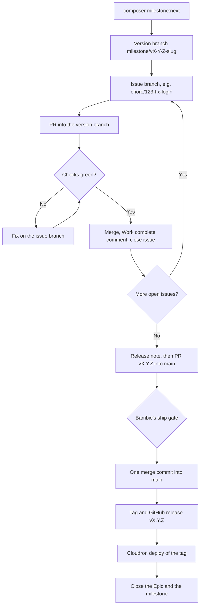

# Contributing

APES Intranet is maintained by APES CIC. Set up Laragon first
([docs/local-development.md](docs/local-development.md)), and check every
change at <http://apes-intranet.test> with the demo data loaded. Terms are
explained in the [glossary](docs/glossary.md).

## How work ships

Each milestone is one version, such as `v0.6.0`. It ships once: every issue is
merged into one version branch, then the version merges into `main` once, is
tagged and released once, and is deployed to Cloudron once.



### The names

| Item | Format | Example |
| --- | --- | --- |
| Version branch | `milestone/vX-Y-Z-<slug>` | `milestone/v0-6-0-hr-training` |
| Issue branch | `<type>/<issue>-<slug>` (`fix`, `feature`, `chore` or `docs`) | `chore/123-fix-login` |
| Issue PR title | `[vX.Y.Z] <summary> (#<issue>)` | `[v0.6.0] Fix the rota filter (#123)` |
| Commit | Conventional Commit with `Refs #<issue>` | `fix: keep the rota filter on reload (Refs #123)` |
| Version PR title | `vX.Y.Z: <milestone name>` | `v0.6.0: HR and training` |
| Tag | `vX.Y.Z` | `v0.6.0` |
| Release title | `vX.Y.Z <milestone name>` | `v0.6.0 HR and training` |

`composer milestone:next` prints all of these for the next version. CI checks
PR titles and branch names (`milestone-version-check`). To check your branch
name before each push, run `git config core.hooksPath .githooks` once.

Never use GitHub's milestone number (such as "Milestone 7", "#7" or "M7") in a
branch, title, commit, tag or release.

Issue titles start with the type: `[Epic]`, `[Story]`, `[Task]`, `[Bug]`,
`[Chore]` or `[Spike]`.

## A worked example: one issue

Say the next version is `v0.6.0 HR and training`, and issue #123 is
`[Bug] The rota filter resets on reload`.

1. **Start.** Run `scripts\preview.ps1`, switch to the version branch, then
   create the issue branch (`composer milestone:branch -- --issue 123` prints
   its name):

   ```powershell
   git switch milestone/v0-6-0-hr-training
   git switch -c fix/123-rota-filter-resets-reload
   ```

   Assign the issue to `apescic-director` and post this comment before
   writing any code:

   ```markdown
   **Work started**
   - Branch: `fix/123-rota-filter-resets-reload`
   - Plan:
     - Keep the filter in the page address
     - Read it back when the page loads
     - Add a test
   - Expected checks: `php artisan test` passes; the filter survives a reload in the preview
   ```

2. **Work.** Commit as you go, for example
   `fix: keep the rota filter on reload (Refs #123)`. Push, then open the PR
   into the version branch:

   ```powershell
   git push -u origin HEAD
   gh pr create --base milestone/v0-6-0-hr-training --title "[v0.6.0] Keep the rota filter on reload (#123)" --body-file report.md
   ```

3. **Progress.** Post a comment at each meaningful point: the PR opened, CI
   failed and what you're doing about it, CI fixed, blocked, or ready for
   review. Not on every commit.

   ```markdown
   **Progress update**
   - Done so far: the filter is kept in the address; PR #130 is open
   - Next: wait for CI
   - Blockers: none
   - Links: PR #130, CI run <link>
   ```

4. **Complete and close.** When the PR has merged into the version branch and
   its checks pass, post the closing comment, then close the issue:

   ```markdown
   **Work complete**
   - What changed: the rota keeps your filter when you reload the page
   - How it was checked: `php artisan test` (all passed); reloaded the rota in the preview
   - PR: #130 (merged into `milestone/v0-6-0-hr-training`)
   - Anything you need to know or do: nothing
   ```

   ```powershell
   gh pr merge 130 --merge --delete-branch
   gh issue close 123 --reason completed
   gh issue view 123 --json state
   ```

   Only start the next issue once this one shows `CLOSED`. GitHub only closes
   issues automatically on merges into `main`, so close it yourself.

In Cursor, `/work-on-issue` does all four steps for you.

## Finishing a version

When every issue is closed:

1. `composer milestone:bump -- vX.Y.Z` creates the release note. Write it by
   [docs/release-notes.md](docs/release-notes.md). The last commit is
   `chore: release vX.Y.Z`, setting `"published": true`.
2. Merge `origin/main` into the version branch, open the PR `vX.Y.Z: <name>`
   into `main` with `Refs #<epic>` (not `Closes`, so the Epic stays open until
   the deploy), and wait for `ci` to go green.
3. Bambie answers the ship gate: a. Merge, b. Release, c. Deploy, d. Merge,
   release and deploy, e. Stop here.
4. Merge with `gh pr merge --merge` (one merge commit), tag `vX.Y.Z` on the
   merge commit, and publish the GitHub release.
5. Deploy with `deploy/cloudron/deploy.ps1 -Tag vX.Y.Z`. `/healthz` must show
   the tag as `version` and its commit as `revision`.
6. `composer milestone:status -- vX.Y.Z` must show no open issues. Then post
   the release summary on the Epic, close the Epic and the milestone, and
   merge `origin/main` into `dependencies`.

In Cursor: `/finish-version`, `/release` and `/deploy`.

## Hotfixes

Only with Bambie's written approval on the issue: a `fix/<issue>-<slug>`
branch from `origin/main`, released as the next patch version through the
same merge, release and deploy steps, then `main` merged back into the open
version branch.
